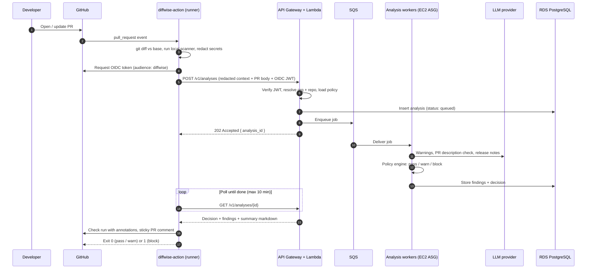
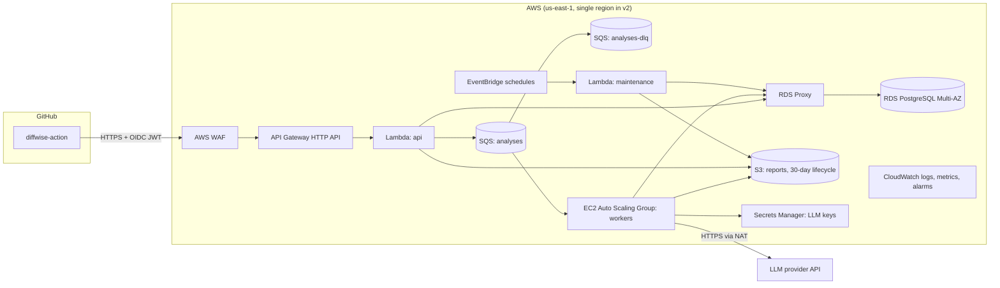
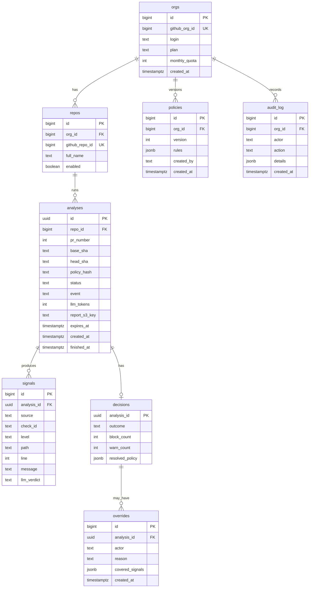

# diffwise Cloud: PR Gate as a Service

Design document for running diffwise as a hosted service on AWS, consumed by any team on GitHub through a reusable GitHub Action. The service turns the existing outputs (scanner findings, warning analysis, Internal Dev Description and Client Release notes) into a single, explainable decision on every pull request: **pass**, **warn** or **block**.

| Field   | Value                         |
| ------- | ----------------------------- |
| Status  | Draft                         |
| Owner   | pato-byepaper                 |
| Created | 2026-11-04                    |
| Version | Targets diffwise 2.0.0        |

---

## 1. Goals and non-goals

### Goals

- **One line of YAML per repo.** Any team adds `uses: pato-byepaper/diffwise-action@v2` and gets a PR gate, with no infrastructure of their own.
- **Warnings vs blocks, decided by policy.** Findings are not just listed. A policy engine decides which ones warn (comment, neutral check) and which ones block (failing required check).
- **Smart gating that understands intent.** The decision considers not only the diff, but also the PR description and the client release notes, and checks that all three agree with each other.
- **Central policy, local overrides.** An organization sets a baseline; repositories can tighten it, and loosen it only where the org allows.
- **Auditable.** Every decision, override and policy version is stored, so "why was this PR blocked?" always has an answer.
- **Keep the privacy guarantees we can keep.** Secrets are redacted inside the GitHub runner, before anything reaches AWS. Source code is never stored at rest by default.

### Non-goals (v2)

- Replacing human code review. The gate catches release risk; reviewers still own design and correctness.
- Supporting GitLab or Bitbucket. The architecture allows it later (the ingest API is provider-neutral), but v2 ships GitHub only.
- Auto-fixing code. The service suggests fixes; it never pushes commits.

---

## 2. How it works, end to end



1. The **Action** runs inside the team's own GitHub runner. It reuses the existing diffwise CLI to collect the change set and run the offline scanner. Secrets are replaced with `[REDACTED:rule-id]` here, so raw credentials never leave GitHub.
2. The Action authenticates with **GitHub OIDC**. No long-lived API key has to be created, rotated or leaked. The service trusts the token's `repository`, `repository_owner` and `ref` claims.
3. The **API** (Lambda behind API Gateway) validates the request, applies quotas and enqueues the job. It answers in milliseconds, so it never hits the API Gateway 29-second limit.
4. **Analysis workers** on EC2 run the long LLM tasks in parallel and feed the results into the policy engine.
5. The Action renders the decision as a **check run** (with inline annotations) and a **sticky PR comment**, then exits non-zero when the decision is `block`. Making the check required in branch protection is what turns "block" into "cannot merge".

### Why the Action does the git work

The runner already has the repository checked out and the permissions to read it. Doing the diff there means the service never needs a GitHub App with `contents: read` on every repository, never clones private code, and only ever receives redacted text. A GitHub App mode (webhooks, no workflow file) is planned for v2.1 for orgs that want zero-config rollout; see section 11.

---

## 3. AWS architecture



### Component responsibilities

| Component                    | Why this service                                                                                                                                        | Responsibilities                                                                                       |
| ---------------------------- | ------------------------------------------------------------------------------------------------------------------------------------------------------- | ------------------------------------------------------------------------------------------------------ |
| **API Gateway (HTTP API)**   | Cheap, managed TLS, throttling, custom domain `api.diffwise.dev`.                                                                                        | Routing, per-route throttling, request size limit (6 MB).                                              |
| **AWS WAF**                  | Blocks abusive traffic before it costs Lambda time.                                                                                                     | Rate limit per IP, AWS managed rule sets, body size rule.                                              |
| **Lambda `api`**             | Bursty, short requests. Scales to zero between PR spikes.                                                                                                | OIDC verification, tenant resolution, quota check, enqueue, status polling, policy CRUD, override API. |
| **SQS + DLQ**                | Decouples ingest from analysis; absorbs Monday-morning PR spikes.                                                                                        | At-least-once delivery, visibility timeout 15 min, 3 retries then DLQ.                                 |
| **EC2 Auto Scaling Group**   | Analysis can take several minutes for large diffs (beyond comfortable Lambda limits), runs several LLM calls concurrently, and keeps warm connection pools. | Runs the worker process: LLM tasks, cross-checks, policy engine, writes results.                        |
| **RDS PostgreSQL (Multi-AZ)** | Relational data: tenants, policies with versions, decisions, overrides, audit log. Strong consistency for "is this PR blocked".                            | System of record.                                                                                      |
| **RDS Proxy**                | Lambda concurrency would otherwise exhaust Postgres connections.                                                                                         | Connection pooling, IAM auth.                                                                           |
| **S3**                       | Large generated reports do not belong in Postgres rows.                                                                                                  | Full Markdown reports (PR description, release notes, issues). SSE-KMS, 30-day lifecycle.              |
| **Secrets Manager**          | Central LLM credentials, rotated without redeploys.                                                                                                      | LLM provider keys, DB credentials for migrations.                                                      |
| **Lambda `maintenance`**     | Scheduled housekeeping.                                                                                                                                 | Purge expired payloads, roll up usage metrics, reset monthly quotas.                                   |
| **CloudWatch**               | Default AWS observability.                                                                                                                              | Logs (no diff content), metrics, alarms, dashboards.                                                   |

### EC2 worker details

- **Instance type:** `c7g.large` (Graviton) to start. Workers are I/O bound on LLM calls, so CPU is not the bottleneck.
- **Scaling:** target tracking on the custom metric `ApproximateNumberOfMessagesVisible / InServiceInstances`, target 4 jobs per instance. Min 1, max 20.
- **Image:** Amazon Linux 2023 AMI built by EC2 Image Builder, Node.js 22, worker installed as a systemd unit. No SSH; access through SSM Session Manager only.
- **Networking:** private subnets, outbound through a NAT gateway (LLM provider only), VPC endpoints for SQS, S3, Secrets Manager and CloudWatch.
- **Graceful shutdown:** lifecycle hook drains in-flight jobs before termination; unfinished messages become visible again through SQS.

> Alternative considered: ECS Fargate for workers. It removes AMI maintenance but costs more per job at steady load. EC2 is the v2 choice; the worker is a plain container-friendly Node process, so moving to Fargate later is a deployment change, not a rewrite.

### Infrastructure as code

All resources are defined in AWS CDK (TypeScript) under `infra/`, with three stacks: `network`, `data` (RDS, S3, KMS) and `app` (API, workers, queues). Environments: `dev`, `staging`, `prod`, each in its own AWS account under AWS Organizations.

---

## 4. The decision engine

This is the "smart" part. Each analysis produces **signals**; the policy engine turns signals into a **decision**.

### 4.1 Signal sources

| Source                        | Produced by                       | Example signals                                                                                                 |
| ----------------------------- | --------------------------------- | --------------------------------------------------------------------------------------------------------------- |
| **Local scanner**             | Action (runner), deterministic    | `anthropic-api-key` critical, `ts-ignore` important, `console-log` minor                                        |
| **Warning analysis**          | Worker, `warnings.md` prompt      | Verdict `Block merge`, confirmed vs false-positive scanner findings, auth or injection warnings W1..Wn          |
| **PR description check**      | Worker, new `pr-consistency.md`   | Description missing, description contradicts diff, undocumented migration, undocumented new env var            |
| **Client release check**      | Worker, `client-release.md` + new `release-consistency.md` | User-facing change with no release note, release note claims something the diff does not show |
| **Metadata**                  | API, from the GitHub event        | Labels, base branch, author association, PR size, touched paths                                                 |

### 4.2 Cross-checks between diff, PR description and release notes

The scanner sees only code. The service also checks that the three stories told about the change agree:

| Check ID                         | Compares                                    | Fires when                                                                                                        | Default level |
| -------------------------------- | ------------------------------------------- | ----------------------------------------------------------------------------------------------------------------- | ------------- |
| `pr.description-missing`         | PR body                                     | Body empty, or only the unedited template                                                                         | warn          |
| `pr.description-contradicts`     | PR body vs diff                             | Body says "no schema changes", "no breaking changes", "docs only", but the diff shows otherwise                    | block         |
| `pr.undocumented-migration`      | Diff vs PR body                             | Migration files or destructive SQL added and not mentioned in the body                                            | block         |
| `pr.undocumented-env-var`        | Diff vs PR body                             | New environment variable read and not listed in the body                                                          | warn          |
| `pr.undocumented-dependency`     | Diff vs PR body                             | New or upgraded dependency not mentioned                                                                          | warn          |
| `release.missing-note`           | Diff vs release section                     | A user-visible change (UI, API response shape, public endpoint) exists, but the PR has no `## Release notes` section | warn          |
| `release.unsupported-claim`      | Release section vs diff                     | A release note bullet is not backed by any change in the diff                                                     | warn          |
| `release.leaks-internals`        | Release section                             | Release note names files, functions, tickets or describes a vulnerability                                         | warn          |
| `release.security-disclosure`    | Release section                             | Release note describes a vulnerability in detail before the fix ships                                             | block         |
| `risk.scope-mismatch`            | PR title / labels vs diff                   | Title says `fix:` or `docs:` but the diff changes auth, payments or infra paths                                   | warn          |

The release notes source is the PR body section `## Release notes` (filled in by the author or generated by `wlu release`). If absent, the worker generates release notes itself and attaches them to the comment as a suggestion, so teams get value even before they adopt the convention.

### 4.3 Policy file

Each repository can commit `.github/diffwise.yml`. The org baseline lives in the service and is edited through the API or the org's `.github` repository.

```yaml
version: 2

# What decides the outcome. Levels: off | warn | block
rules:
  scanner:
    critical: block
    important: warn
    minor: off
  warnings:
    verdict-block-merge: block        # LLM verdict "Block merge"
    verdict-merge-after-fixes: warn
  pr:
    description-missing: warn
    description-contradicts: block
    undocumented-migration: block
    undocumented-env-var: warn
  release:
    missing-note: warn
    security-disclosure: block

# Tighter rules on sensitive paths
paths:
  - match: ["src/billing/**", "src/auth/**", "infra/**"]
    rules:
      scanner:
        important: block
      release:
        missing-note: block

# Tighter rules when merging into release branches
branches:
  - match: ["release/*", "main"]
    rules:
      warnings:
        verdict-merge-after-fixes: block

# How a block can be overridden
overrides:
  label: "diffwise:override"          # adding this label re-runs and downgrades block -> warn
  require-reason: true                # reason must be given in a /diffwise override <reason> comment
  allowed-teams: ["@acme/security", "@acme/tech-leads"]
  never-overridable: ["scanner.critical"]   # a live secret can never be waved through

# Paths ignored completely
ignore:
  - "**/*.snap"
  - "docs/**"

# Escalation: many warnings in one PR become a block
escalate:
  warn-count-to-block: 8
```

### 4.4 Precedence and the decision algorithm

1. Start from the **org baseline**.
2. Apply the **repo file**. A repo may tighten any rule. It may loosen a rule only if the org marked it `repo-overridable: true`. Loosening a locked rule is ignored and reported as a warning in the comment.
3. Apply **branch** rules, then **path** rules (path rules apply only to findings located in matching files).
4. Map every signal to a level. Signals on `ignore` paths are dropped.
5. Deduplicate: a scanner finding the LLM marked **False positive** is downgraded one level (block -> warn, warn -> off) and labeled as such. A finding marked **Confirmed** keeps its level.
6. Escalate: if the number of `warn` signals reaches `warn-count-to-block`, add a synthetic `risk.too-many-warnings` block.
7. Apply **overrides** (section 4.5).
8. Decision = `block` if any block remains, else `warn` if any warn remains, else `pass`.

The worker stores the resolved policy snapshot alongside the decision, so later policy edits never change the explanation of a past decision.

### 4.5 Overrides

- A member of `allowed-teams` comments `/diffwise override <reason>` and adds the override label. The Action re-runs, verifies team membership through the GitHub API, and the service downgrades overridable blocks to warn.
- The override, the actor, the reason and the exact findings it covered are written to the `overrides` and `audit_log` tables.
- A new push invalidates the override; a fresh analysis runs and must be overridden again if it still blocks.
- `never-overridable` rules stay blocking. The only fix is to change the code (and rotate the secret).

### 4.6 LLM failure handling

The gate must not become flaky because a model is slow or down.

| Situation                                     | Behavior                                                                                                       |
| --------------------------------------------- | -------------------------------------------------------------------------------------------------------------- |
| LLM timeout or error after retries            | LLM-derived signals are skipped. Decision uses scanner + metadata only. Comment says "AI checks unavailable".   |
| Service unreachable from the Action           | Action falls back to `wlu scan --fail-on critical` locally. Configurable: `on-service-error: fail-open | fail-closed`. |
| Malformed LLM output                          | Parsed with a strict schema (JSON mode). Unparseable sections are dropped, never guessed.                     |
| Same PR re-analyzed with no new commits       | Cached decision returned (key: repo + head SHA + base SHA + policy hash).                                     |

Default is `fail-open` for warn-level checks and deterministic scanner blocks always enforced, because those run in the runner and do not depend on AWS.

---

## 5. The GitHub Action

Published as `pato-byepaper/diffwise-action`, a composite action that wraps the existing CLI.

### Consumer workflow

```yaml
# .github/workflows/diffwise.yml
name: diffwise
on:
  pull_request:
    types: [opened, synchronize, reopened, edited, labeled, unlabeled]
  issue_comment:
    types: [created]

permissions:
  contents: read
  pull-requests: write   # sticky comment
  checks: write          # check run + annotations
  id-token: write        # OIDC token for the diffwise service

concurrency:
  group: diffwise-${{ github.event.pull_request.number || github.event.issue.number }}
  cancel-in-progress: true

jobs:
  gate:
    if: github.event_name == 'pull_request' || startsWith(github.event.comment.body, '/diffwise')
    runs-on: ubuntu-latest
    steps:
      - uses: actions/checkout@v4
        with:
          fetch-depth: 0
      - uses: pato-byepaper/diffwise-action@v2
        with:
          mode: gate                # gate | report (report never fails the job)
          on-service-error: fail-open
```

`edited` is included on purpose: changing the PR description or release notes re-runs the cross-checks without a new push. On `edited` events the worker reuses cached diff analysis and only re-runs the description and release checks.

### Action inputs and outputs

| Input              | Default                     | Description                                                     |
| ------------------ | --------------------------- | --------------------------------------------------------------- |
| `mode`             | `gate`                      | `gate` exits 1 on block. `report` only comments.                |
| `api-url`          | `https://api.diffwise.dev`  | Override for self-hosted deployments.                           |
| `policy-file`      | `.github/diffwise.yml`      | Repo policy path.                                               |
| `on-service-error` | `fail-open`                 | `fail-open` or `fail-closed`.                                   |
| `comment`          | `sticky`                    | `sticky`, `new` or `off`.                                       |
| `timeout-minutes`  | `10`                        | Max time waiting for the service.                               |

| Output          | Description                                  |
| --------------- | -------------------------------------------- |
| `decision`      | `pass`, `warn` or `block`.                   |
| `analysis-id`   | Service ID, links to the full report.        |
| `block-count`   | Number of blocking signals.                  |
| `warn-count`    | Number of warning signals.                   |

### What the PR sees

- **Check run** `diffwise / gate`: conclusion `success` (pass), `neutral` (warn) or `failure` (block). Annotations on the exact lines (batched 50 per API call, GitHub's limit).
- **Sticky comment**, updated in place:

```markdown
## diffwise: Blocked (2 blocking, 3 warnings)

| Level | Check                        | Where                     | Why                                                        |
| ----- | ---------------------------- | ------------------------- | ---------------------------------------------------------- |
| Block | scanner: stripe-live-secret  | `src/pay/client.ts:14`    | Live Stripe key committed. Rotate it, then remove it.      |
| Block | pr.undocumented-migration    | `db/migrate/0042_drop.sql`| Drops `invoices.legacy_id`; PR body does not mention it.   |
| Warn  | release.missing-note         | `src/ui/Invoice.tsx`      | Invoice screen changed; add a `## Release notes` section.  |
| Warn  | pr.undocumented-env-var      | `src/config.ts:31`        | `BILLING_REGION` is new and not listed in the description. |
| Warn  | scanner: console-log         | `src/pay/client.ts:40`    | Debug logging left in.                                     |

<details><summary>Suggested release notes</summary>

- Improved invoice totals to show tax separately.
</details>

Policy `acme/baseline@v7` + repo overrides. Override: `/diffwise override <reason>` (security, tech-leads).
```

Making `diffwise / gate` a **required status check** in branch protection or a repository ruleset is what physically prevents merging on `block`. The rollout guide tells teams to do this only after one or two weeks in `report` mode.

---

## 6. API

Base URL `https://api.diffwise.dev/v1`. All endpoints require either a GitHub OIDC JWT (from Actions) or a GitHub OAuth session (from the dashboard).

| Method | Path                              | Purpose                                                       |
| ------ | --------------------------------- | ------------------------------------------------------------- |
| POST   | `/analyses`                       | Submit redacted context. Returns `202 { id }`.                |
| GET    | `/analyses/{id}`                  | Status, decision, signals, comment Markdown.                  |
| POST   | `/analyses/{id}/overrides`        | Record an override (Action calls it after verifying the team). |
| GET    | `/orgs/{org}/policy`              | Current baseline policy.                                      |
| PUT    | `/orgs/{org}/policy`              | Publish a new baseline version (org admins).                  |
| GET    | `/orgs/{org}/analyses?repo=&decision=` | History for dashboards.                                  |
| GET    | `/orgs/{org}/usage`               | Analyses and LLM tokens this month.                           |

### `POST /analyses` body

```json
{
  "schema": 2,
  "repo": "acme/billing-api",
  "pr": { "number": 482, "title": "feat(invoices): show tax line", "body": "...", "labels": ["billing"], "author_association": "MEMBER" },
  "base": { "ref": "main", "sha": "a1b2c3d" },
  "head": { "ref": "feat/tax-line", "sha": "e4f5a6b" },
  "event": "pull_request.synchronize",
  "stats": { "files": 12, "additions": 340, "deletions": 51 },
  "commits": ["feat(invoices): show tax line", "test: tax rounding"],
  "files": [{ "path": "src/ui/Invoice.tsx", "status": "modified", "additions": 40, "deletions": 8 }],
  "scanner_findings": [{ "rule": "console-log", "severity": "minor", "path": "src/pay/client.ts", "line": 40 }],
  "diff": "<redacted agent-ready markdown, max 600000 chars>",
  "repo_policy": "<contents of .github/diffwise.yml>",
  "client": { "action_version": "2.0.0", "cli_version": "2.0.0" }
}
```

The `diff` field is already redacted by `src/scanner.js` in the runner. The API re-runs the secret rules over it as a second line of defense and rejects the request with `422` if anything unredacted is found.

---

## 7. Data model (RDS PostgreSQL)



- Unique index on `analyses (repo_id, head_sha, base_sha, policy_hash)` backs the result cache and makes duplicate SQS deliveries idempotent.
- `signals.message` stores the finding text, never the code excerpt. The redacted diff lives in the SQS message and, only for the run, in worker memory.
- `audit_log` is append-only (no `UPDATE` / `DELETE` grants for the app role).
- Migrations with `node-pg-migrate`, run from a one-off CodeBuild job, never from Lambda cold starts.

---

## 8. Security and privacy

The current README promises "ByePaper never sees your code". The hosted service changes that for teams who opt in, so the promise has to be restated precisely and the local CLI must keep working exactly as today.

| Concern                         | Control                                                                                                                                         |
| ------------------------------- | ----------------------------------------------------------------------------------------------------------------------------------------------- |
| Secrets in diffs                | Redacted in the runner by the existing scanner; re-checked at the API; request rejected if any secret pattern survives.                         |
| Code at rest                    | Not stored. Diff text exists only in the SQS message (SSE-KMS, 4-day max retention, deleted on success) and worker memory.                      |
| Reports at rest                 | Generated Markdown in S3, SSE-KMS with a per-environment CMK, 30-day lifecycle, configurable to 0 days (comment only).                        |
| Authentication                  | GitHub OIDC JWT, verified against GitHub's JWKS. `aud` must equal `diffwise`. `repository_owner_id` must match an enabled org.                   |
| Tenant isolation                | Every query is scoped by `org_id` resolved from the token, never from the request body. Postgres row-level security as a second guard.          |
| LLM provider                    | Only redacted text is sent. Provider configured with zero data retention where available. Orgs can choose a provider or disable LLM checks.     |
| Prompt injection from the diff  | Diff content is wrapped as data in prompts; LLM output is parsed into a strict schema; the LLM can only produce signals, never change policy.    |
| Fork PRs                        | `pull_request` from forks gets no OIDC token with secrets access; the Action runs in scanner-only local mode. No `pull_request_target`.        |
| Network                         | Workers and RDS in private subnets. RDS only reachable through RDS Proxy with IAM auth. No public IPs on EC2.                                   |
| Logging                         | Structured logs contain IDs, counts and timings only. A log filter test fails CI if diff or PR body fields are logged.                          |
| Compliance path                 | CloudTrail on all accounts, AWS Config rules, GuardDuty. SOC 2 readiness tracked separately.                                                     |

**Self-hosting:** the CDK app is part of the open-source repo. Teams that cannot send code to a third party deploy the same stack into their own AWS account and set `api-url`.

---

## 9. Operations

### SLOs

| SLO                                         | Target          |
| ------------------------------------------- | --------------- |
| API availability (`POST`, `GET /analyses`)  | 99.9% monthly   |
| Decision latency, p50 / p95 (diffs < 2k lines) | 45 s / 3 min |
| Scanner-only decision when LLM is down      | < 20 s          |

### Alarms

- DLQ depth > 0 for 5 minutes.
- Queue age of oldest message > 5 minutes.
- Worker error rate > 5% over 10 minutes.
- LLM error rate > 10% over 10 minutes (switches the comment banner to "AI checks degraded").
- RDS CPU > 70% or free storage < 20%.

### Cost estimate (prod, 50 orgs, ~20k analyses/month)

| Item                                  | Monthly (USD, rough) |
| ------------------------------------- | -------------------- |
| EC2 workers (avg 3 x c7g.large)       | 160                  |
| RDS PostgreSQL db.t4g.medium Multi-AZ | 140                  |
| RDS Proxy                             | 25                   |
| NAT gateway + data                    | 45                   |
| Lambda + API Gateway + SQS            | 15                   |
| S3, KMS, Secrets Manager, CloudWatch  | 30                   |
| **Infrastructure total**              | **~415**             |
| LLM tokens (dominant, ~4 calls/analysis) | Depends on model and diff size; tracked per org in `analyses.llm_tokens` |

Per-org monthly quotas protect against runaway LLM spend. Above quota, analyses run in scanner-only mode and the comment says so.

---

## 10. Changes to this repository

| Area                         | Change                                                                                                        |
| ---------------------------- | ------------------------------------------------------------------------------------------------------------- |
| `src/cli.js`                 | New `wlu ci` command: collect, scan, redact, emit the `POST /analyses` payload as JSON.                        |
| `src/llm/`                   | Extract `src/gemini.js` behind a provider interface so workers can use other providers (e.g. Claude via Amazon Bedrock). |
| `src/policy.js`              | New. Pure policy resolution + decision function, shared by worker and CLI (`wlu gate --policy` works offline). |
| `prompts/`                   | New `pr-consistency.md` and `release-consistency.md`. `warnings.md` gets a JSON output variant.               |
| `service/`                   | New. `api` Lambda handler and `worker` process.                                                               |
| `infra/`                     | New. AWS CDK stacks.                                                                                          |
| `action/`                    | New. Composite action, published to `pato-byepaper/diffwise-action` by a release workflow.                     |
| `README.md`, `SECURITY.md`   | Separate "Local CLI" and "diffwise Cloud" privacy sections.                                                   |
| `test/`                      | Policy engine table tests, payload schema tests, redaction re-check tests.                                    |

Keeping `src/policy.js` pure and shared means the same `.github/diffwise.yml` gives the same decision locally, in self-hosted deployments and in the cloud.

---

## 11. Rollout plan

| Phase | Scope                                                                                                     | Exit criteria                                                         |
| ----- | --------------------------------------------------------------------------------------------------------- | --------------------------------------------------------------------- |
| 0     | `wlu ci` + `src/policy.js` locally; Action in scanner-only mode (no AWS).                                 | Teams can block on scanner findings with the policy file today.       |
| 1     | AWS stack in `dev`/`staging`; warning analysis only; `report` mode for 2 pilot teams.                     | p95 latency met; false-positive rate on blocks < 5% over 2 weeks.     |
| 2     | PR description and release cross-checks; overrides; sticky comment; `gate` mode for pilots.              | Pilot teams make the check required; no unexplained blocks reported. |
| 3     | General availability: org baseline policies, dashboard, quotas, self-hosting guide.                       | 10 orgs onboarded.                                                    |
| 4 (v2.1) | GitHub App mode (webhooks to API Gateway, no workflow file), merge queue support (`merge_group` event). | Zero-config org installs.                                             |

---

## 12. Open questions

1. **LLM provider default:** stay on Gemini, or default to Claude through Amazon Bedrock so traffic stays inside AWS and under the same data-processing agreement?
2. **Release notes source of truth:** PR body section, a `CHANGELOG.md` entry, or a changeset file (`.changeset/*.md`)? The cross-check can support all three; the default needs a decision.
3. **Override authority:** GitHub team membership (needs `read:org`, which the default `GITHUB_TOKEN` cannot do) or CODEOWNERS approval of the PR? CODEOWNERS works with default permissions.
4. **Pricing:** free tier size and whether scanner-only mode stays free forever.
5. **Multi-region:** is single-region `us-east-1` acceptable for EU customers, or is `eu-west-1` needed at GA?
