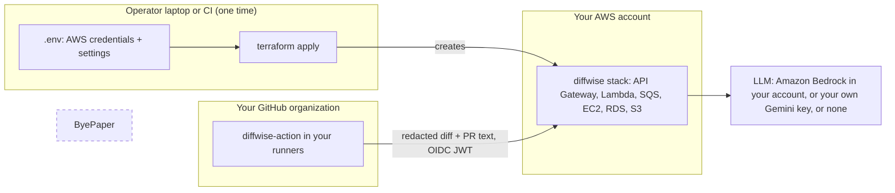
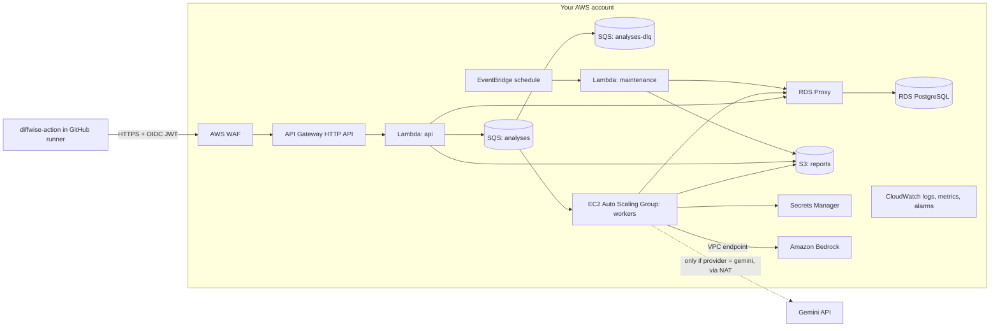
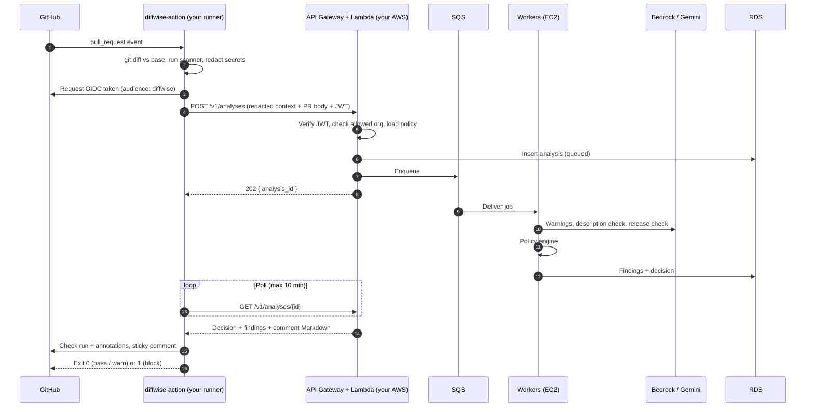
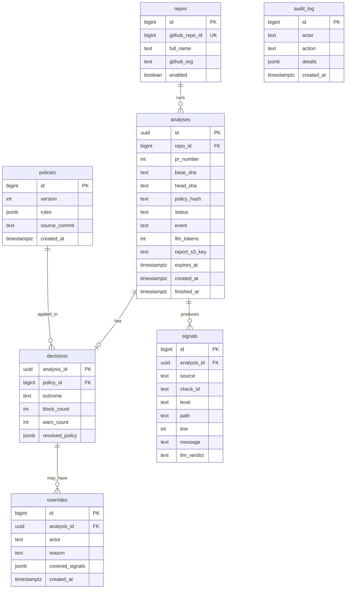

# diffwise Self-Hosted PR Gate

Design document for running diffwise as a PR gate **inside your own AWS account**, deployed with Terraform and used by any team in your GitHub organization through a reusable GitHub Action. It turns the existing outputs (scanner findings, warning analysis, Internal Dev Description and Client Release notes) into a single, explainable decision on every pull request: **pass**, **warn** or **block**.

**Nothing goes to ByePaper.** There is no ByePaper service, account, license server or telemetry. You put your AWS credentials in a local `.env`, run Terraform, and the whole stack is created in your AWS account. Your code, your diffs, your findings and your reports stay in your GitHub runners and your AWS account.

| Field   | Value                  |
| ------- | ---------------------- |
| Status  | Draft                  |
| Owner   | pato-byepaper          |
| Created | 2026-11-04             |
| Version | Targets diffwise 2.0.0 |

---

## 1. Goals and non-goals

### Goals

- **Self-hosted by design.** One `terraform apply` from a laptop or a CI job creates everything in the user's AWS account. ByePaper never receives code, metadata or usage data.
- **Setup from a `.env`.** AWS credentials and a few settings in `.env`, then a single deploy command. No console clicking.
- **One line of YAML per repo.** Teams add `uses: pato-byepaper/diffwise-action@v2` with the URL their Terraform printed, and get a PR gate.
- **Warnings vs blocks, decided by policy.** A policy engine decides which findings warn (comment, neutral check) and which block (failing required check).
- **Smart gating that understands intent.** The decision looks at the diff, the PR description and the client release notes, and checks that all three agree.
- **Central policy, per-repo overrides.** The platform team sets a baseline for the whole organization; repositories can tighten it, and loosen it only where the baseline allows.
- **Auditable.** Every decision, override and policy version is stored in the user's own database.
- **Clean teardown.** `terraform destroy` removes everything.

### Non-goals (v2)

- A ByePaper-hosted SaaS. There is none, and the design must not depend on one.
- Replacing human code review. The gate catches release risk; reviewers still own design and correctness.
- GitLab, Bitbucket, Azure or GCP. The structure allows other Terraform providers later, but v2 ships AWS + GitHub only.
- Auto-fixing code. The gate suggests fixes; it never pushes commits.

---

## 2. Who talks to whom



ByePaper is drawn only to make the point: no arrow goes to it. The only code ByePaper ships is open source (the CLI, the Action, the Terraform modules), which you pull from GitHub at a version you pin.

The only data that leaves your AWS account is what you choose to send to an LLM:

| LLM option                     | Where the redacted diff goes                                      | Internet egress needed |
| ------------------------------ | ----------------------------------------------------------------- | ---------------------- |
| **Amazon Bedrock** (default)   | Bedrock in your own account and region, through a VPC endpoint.   | No                     |
| **Gemini** (your API key)      | Google Gemini API, directly from your workers.                    | Yes (NAT gateway)      |
| **Offline**                    | Nowhere. Scanner and deterministic checks only.                    | No                     |

---

## 3. Setup

### 3.1 Prerequisites

- Terraform 1.9+ and Node.js 22+ on the machine that deploys.
- An AWS account (a dedicated one is recommended) and credentials allowed to create VPC, IAM, Lambda, API Gateway, SQS, EC2, RDS, S3, KMS, Secrets Manager and CloudWatch resources.
- An S3 bucket for Terraform state (or let the bootstrap step create one).
- If using Bedrock: model access enabled for the chosen model in the chosen region.

### 3.2 `.env`

The deploy reads a `.env` in the folder where diffwise is cloned. It is already covered by `.gitignore`.

```sh
# --- AWS credentials (used only on this machine, only by Terraform) ---
AWS_ACCESS_KEY_ID=
AWS_SECRET_ACCESS_KEY=
# AWS_SESSION_TOKEN=          # if using temporary credentials (recommended)
# AWS_PROFILE=                # alternative to the keys above (SSO / named profile)
AWS_REGION=us-east-1

# --- Terraform state ---
DIFFWISE_TF_STATE_BUCKET=acme-diffwise-tfstate
DIFFWISE_ENVIRONMENT=prod                 # prefix for every resource name

# --- Who may call the gate ---
DIFFWISE_ALLOWED_GITHUB_ORGS=acme,acme-labs   # OIDC tokens from any other org are rejected

# --- LLM ---
DIFFWISE_LLM_PROVIDER=bedrock             # bedrock | gemini | offline
DIFFWISE_BEDROCK_MODEL_ID=                # e.g. an Anthropic Claude model id available in your region
# GEMINI_API_KEY=                         # only if DIFFWISE_LLM_PROVIDER=gemini
# GEMINI_MODEL=gemini-3.8-flash

# --- Sizing (optional) ---
# DIFFWISE_WORKER_INSTANCE_TYPE=c7g.large
# DIFFWISE_WORKER_MIN=1
# DIFFWISE_WORKER_MAX=10
# DIFFWISE_DB_INSTANCE_CLASS=db.t4g.medium
# DIFFWISE_DB_MULTI_AZ=true
# DIFFWISE_REPORT_RETENTION_DAYS=30
```

Credential guidance in the docs:

- Prefer temporary credentials (`AWS_SESSION_TOKEN` or `AWS_PROFILE` with SSO) over long-lived access keys.
- The credentials are used only by Terraform on the deploy machine. They are never put in GitHub, never stored in Terraform state, and never used by the running stack. The stack runs on IAM roles that Terraform creates.
- A ready-made least-privilege IAM policy for the deployer is shipped as `infra/terraform/deployer-policy.json`.

### 3.3 Deploy

```sh
git clone https://github.com/pato-byepaper/diffwise.git
cd diffwise
cp .env.example .env          # fill in the values above
wlu cloud deploy              # loads .env, runs terraform init + plan, asks, then applies
```

`wlu cloud deploy` is a thin wrapper. It loads `.env`, maps the `DIFFWISE_*` values to `TF_VAR_*`, and runs plain Terraform in `infra/terraform`. Teams that already have a Terraform workflow can skip the wrapper and use the module directly:

```hcl
module "diffwise" {
  source = "github.com/pato-byepaper/diffwise//infra/terraform?ref=v2.0.0"

  environment          = "prod"
  allowed_github_orgs  = ["acme", "acme-labs"]
  llm_provider         = "bedrock"
  bedrock_model_id     = var.bedrock_model_id
  report_retention_days = 30
}

output "diffwise_api_url" {
  value = module.diffwise.api_url
}
```

When apply finishes it prints:

```text
diffwise_api_url = "https://abc123.execute-api.us-east-1.amazonaws.com"
next_step        = "Set the GitHub organization variable DIFFWISE_API_URL to this value."
```

### 3.4 Connect GitHub

1. In GitHub organization settings, add an **Actions variable** `DIFFWISE_API_URL` with the printed URL. It is a URL, not a secret.
2. No GitHub secret is needed. The Action authenticates with GitHub OIDC, and the stack only accepts tokens from `DIFFWISE_ALLOWED_GITHUB_ORGS`.
3. Teams add the workflow in section 6.

### 3.5 Upgrade and teardown

```sh
git pull && git checkout v2.1.0
wlu cloud deploy              # terraform apply with the new module version; DB migrations run as part of it
wlu cloud destroy             # terraform destroy; asks for confirmation, keeps a final RDS snapshot by default
```

---

## 4. AWS architecture (what Terraform creates)



### Components

| Component                     | Why this service                                                                                                         | Responsibilities                                                                                      |
| ----------------------------- | ------------------------------------------------------------------------------------------------------------------------ | ----------------------------------------------------------------------------------------------------- |
| **API Gateway (HTTP API)**    | Managed TLS, throttling, cheap at PR-level traffic. Optional custom domain via an input variable.                         | Routing, per-route throttling, request size limit.                                                    |
| **AWS WAF**                   | Rejects abusive traffic before it costs Lambda time.                                                                     | Rate limit per IP, AWS managed rule sets, body size rule. Optional (`enable_waf`).                    |
| **Lambda `api`**              | Short, bursty requests; scales to zero between PR spikes.                                                                | OIDC verification, allowed-org check, enqueue, status polling, policy and override endpoints.        |
| **SQS + DLQ**                 | Decouples intake from analysis and absorbs PR spikes.                                                                    | At-least-once delivery, visibility timeout 15 min, 3 attempts then DLQ.                               |
| **EC2 Auto Scaling Group**    | Large diffs take minutes, several LLM calls run concurrently, warm connection pools.                                     | Worker process: LLM tasks, cross-checks, policy engine, writes results.                               |
| **RDS PostgreSQL**            | Relational data with strong consistency: policies with versions, decisions, overrides, audit log.                         | System of record. Multi-AZ optional (`db_multi_az`).                                                  |
| **RDS Proxy**                 | Lambda concurrency would otherwise exhaust Postgres connections.                                                         | Connection pooling, IAM database auth.                                                                |
| **S3**                        | Full Markdown reports do not belong in table rows.                                                                       | Generated reports. SSE-KMS, lifecycle expiry from `report_retention_days`. Public access blocked.     |
| **KMS**                       | One customer-managed key for the stack.                                                                                  | Encrypts RDS, S3, SQS, Secrets Manager and CloudWatch logs.                                           |
| **Secrets Manager**           | Keeps the Gemini key (if used) and DB admin credentials out of code and user data.                                        | Read by workers at start-up through their IAM role.                                                   |
| **Lambda `maintenance`**      | Scheduled housekeeping.                                                                                                  | Purge expired rows and reports, roll up metrics.                                                      |
| **CloudWatch**                | Default AWS observability.                                                                                               | Logs (no diff content), metrics, alarms, one dashboard. Alarm emails go to `alarm_email` if set.     |

### EC2 workers

- **Instance:** `c7g.large` (Graviton) by default. Workers are I/O bound on LLM calls.
- **Image:** latest Amazon Linux 2023 AMI looked up by Terraform. User data installs Node.js and the diffwise release tarball for the exact pinned version from GitHub Releases, verified against its SHA-256 checksum, and runs the worker as a systemd unit.
- **Scaling:** target tracking on queue depth per instance (default 4 jobs per instance), min and max from `.env`.
- **Access:** no SSH and no public IP. SSM Session Manager only.
- **Network:** private subnets. With Bedrock or offline, no NAT gateway is created and the stack has no route to the internet at all; AWS services are reached through VPC endpoints. With Gemini, Terraform adds a NAT gateway.
- **Graceful shutdown:** lifecycle hook drains in-flight jobs before termination.

> Alternative considered: ECS Fargate for workers. It removes instance management but costs more at steady load. The worker is a plain Node process, so a `worker_runtime = "fargate"` option can be added later without a rewrite.

### Terraform layout

```text
infra/terraform/
  main.tf                 Root module wiring
  variables.tf            All inputs (mapped from .env by wlu cloud deploy)
  outputs.tf              api_url, dashboard_url, next_step
  versions.tf             Provider pins, S3 backend
  deployer-policy.json    Least-privilege IAM policy for whoever runs apply
  modules/
    network/              VPC, private subnets, VPC endpoints, optional NAT
    data/                 KMS, RDS, RDS Proxy, S3 reports bucket
    queue/                SQS + DLQ
    api/                  API Gateway, WAF, api Lambda, IAM role
    workers/              Launch template, ASG, scaling policies, IAM role
    maintenance/          EventBridge schedule + Lambda
    observability/        Log groups, alarms, dashboard, SNS topic
```

Every resource is tagged `app = diffwise` and `environment = <DIFFWISE_ENVIRONMENT>`, and every name is prefixed, so several environments (for example `staging` and `prod`) can live in one account.

---

## 5. The decision engine

This is the "smart" part. Each analysis produces **signals**; the policy engine turns signals into a **decision**.

### 5.1 Signal sources

| Source                    | Produced by                                                 | Example signals                                                                                         |
| ------------------------- | ----------------------------------------------------------- | ------------------------------------------------------------------------------------------------------- |
| **Local scanner**         | Action (runner), deterministic                              | `anthropic-api-key` critical, `ts-ignore` important, `console-log` minor                                |
| **Warning analysis**      | Worker, `warnings.md` prompt                                | Verdict `Block merge`, confirmed vs false-positive scanner findings, auth or injection warnings W1..Wn  |
| **PR description check**  | Worker, new `pr-consistency.md`                             | Description missing, contradicts diff, undocumented migration, undocumented new env var                 |
| **Client release check**  | Worker, `client-release.md` + new `release-consistency.md`  | User-facing change with no release note, release note not backed by the diff                            |
| **Metadata**              | API, from the GitHub event                                  | Labels, base branch, author association, PR size, touched paths                                         |

### 5.2 Cross-checks between diff, PR description and release notes

The scanner sees only code. The gate also checks that the three stories told about the change agree:

| Check ID                        | Compares                   | Fires when                                                                                                         | Default level |
| ------------------------------- | -------------------------- | ------------------------------------------------------------------------------------------------------------------ | ------------- |
| `pr.description-missing`        | PR body                    | Body empty, or only the unedited template                                                                          | warn          |
| `pr.description-contradicts`    | PR body vs diff            | Body says "no schema changes", "no breaking changes", "docs only", but the diff shows otherwise                     | block         |
| `pr.undocumented-migration`     | Diff vs PR body            | Migration files or destructive SQL added and not mentioned in the body                                             | block         |
| `pr.undocumented-env-var`       | Diff vs PR body            | New environment variable read and not listed in the body                                                           | warn          |
| `pr.undocumented-dependency`    | Diff vs PR body            | New or upgraded dependency not mentioned                                                                           | warn          |
| `release.missing-note`          | Diff vs release section    | A user-visible change (UI, API response shape, public endpoint) exists, but the PR has no `## Release notes` section | warn          |
| `release.unsupported-claim`     | Release section vs diff    | A release note bullet is not backed by any change in the diff                                                      | warn          |
| `release.leaks-internals`       | Release section            | Release note names files, functions or tickets                                                                     | warn          |
| `release.security-disclosure`   | Release section            | Release note describes a vulnerability in detail before the fix ships                                              | block         |
| `risk.scope-mismatch`           | PR title / labels vs diff  | Title says `fix:` or `docs:` but the diff changes auth, payments or infra paths                                    | warn          |

The release notes source is the PR body section `## Release notes` (written by the author or generated with `wlu release`). If it is missing, the worker generates release notes and attaches them to the comment as a suggestion.

### 5.3 Policy file

Each repository can commit `.github/diffwise.yml`. The organization baseline is stored in the stack's database and managed from one repository chosen at deploy time (default: the org's `.github` repository, file `diffwise/baseline.yml`), so changing it is a reviewed PR, not a console edit.

```yaml
version: 2

# Levels: off | warn | block
rules:
  scanner:
    critical: block
    important: warn
    minor: off
  warnings:
    verdict-block-merge: block        # LLM verdict "Block merge"
    verdict-merge-after-fixes: warn
  pr:
    description-missing: warn
    description-contradicts: block
    undocumented-migration: block
    undocumented-env-var: warn
  release:
    missing-note: warn
    security-disclosure: block

# Tighter rules on sensitive paths
paths:
  - match: ["src/billing/**", "src/auth/**", "infra/**"]
    rules:
      scanner:
        important: block
      release:
        missing-note: block

# Tighter rules when merging into release branches
branches:
  - match: ["release/*", "main"]
    rules:
      warnings:
        verdict-merge-after-fixes: block

# How a block can be overridden
overrides:
  label: "diffwise:override"
  require-reason: true                       # /diffwise override <reason>
  allowed: codeowners                        # codeowners | teams
  never-overridable: ["scanner.critical"]    # a live secret can never be waved through

# Paths ignored completely
ignore:
  - "**/*.snap"
  - "docs/**"

# Many warnings in one PR become a block
escalate:
  warn-count-to-block: 8
```

### 5.4 Precedence and the decision algorithm

1. Start from the **org baseline**.
2. Apply the **repo file**. A repo may tighten any rule. It may loosen a rule only if the baseline marks it `repo-overridable: true`. Attempts to loosen a locked rule are ignored and reported in the comment.
3. Apply **branch** rules, then **path** rules (path rules apply only to findings in matching files).
4. Map every signal to a level. Signals on `ignore` paths are dropped.
5. Deduplicate: a scanner finding the LLM marks **False positive** is downgraded one level (block to warn, warn to off) and labeled as such. **Confirmed** findings keep their level.
6. Escalate: if `warn` signals reach `warn-count-to-block`, add a synthetic `risk.too-many-warnings` block.
7. Apply **overrides** (5.5).
8. Decision = `block` if any block remains, else `warn` if any warn remains, else `pass`.

The resolved policy snapshot is stored with each decision, so later policy edits never change the explanation of a past decision.

### 5.5 Overrides

- An allowed person (a CODEOWNER of the blocked files by default, or a member of listed teams) comments `/diffwise override <reason>` and adds the override label. The Action re-runs, verifies the person, and the gate downgrades overridable blocks to warn.
- The override, actor, reason and covered findings are written to `overrides` and `audit_log`.
- A new push invalidates the override; the new analysis must be overridden again if it still blocks.
- `never-overridable` rules stay blocking. The only fix is to change the code (and rotate the secret).

### 5.6 Failure handling

The gate must not become flaky because a model or the stack is unavailable.

| Situation                                | Behavior                                                                                                             |
| ---------------------------------------- | -------------------------------------------------------------------------------------------------------------------- |
| LLM timeout or error after retries       | LLM-derived signals are skipped. Decision uses scanner + metadata. Comment says "AI checks unavailable".             |
| Stack unreachable from the Action        | Action falls back to `wlu scan --fail-on critical` locally. `on-service-error: fail-open` (default) or `fail-closed`. |
| Malformed LLM output                     | Parsed with a strict JSON schema. Unparseable sections are dropped, never guessed.                                   |
| Same PR re-analyzed, no new commits      | Cached decision returned (key: repo + head SHA + base SHA + policy hash).                                            |

Scanner blocks are always enforced, because the scanner runs in the runner and does not depend on AWS.

---

## 6. The GitHub Action

Published as `pato-byepaper/diffwise-action`, a composite action that wraps the existing CLI. It only talks to the URL you give it.

### Consumer workflow

```yaml
# .github/workflows/diffwise.yml
name: diffwise
on:
  pull_request:
    types: [opened, synchronize, reopened, edited, labeled, unlabeled]
  issue_comment:
    types: [created]

permissions:
  contents: read
  pull-requests: write   # sticky comment
  checks: write          # check run + annotations
  id-token: write        # OIDC token for YOUR diffwise stack

concurrency:
  group: diffwise-${{ github.event.pull_request.number || github.event.issue.number }}
  cancel-in-progress: true

jobs:
  gate:
    if: github.event_name == 'pull_request' || startsWith(github.event.comment.body, '/diffwise')
    runs-on: ubuntu-latest
    steps:
      - uses: actions/checkout@v4
        with:
          fetch-depth: 0
      - uses: pato-byepaper/diffwise-action@v2
        with:
          api-url: ${{ vars.DIFFWISE_API_URL }}
          mode: gate                 # gate | report (report never fails the job)
          on-service-error: fail-open
```

`edited` is included on purpose: changing the PR description or release notes re-runs the cross-checks without a new push. On `edited` events the worker reuses the cached diff analysis and only re-runs the description and release checks.

### Request flow



The runner already has the repository checked out, so the stack never needs repository access, never clones code and only receives redacted text.

### Inputs and outputs

| Input              | Default                | Description                                          |
| ------------------ | ---------------------- | ---------------------------------------------------- |
| `api-url`          | required               | The `diffwise_api_url` output of your Terraform.     |
| `mode`             | `gate`                 | `gate` exits 1 on block. `report` only comments.     |
| `policy-file`      | `.github/diffwise.yml` | Repo policy path.                                    |
| `on-service-error` | `fail-open`            | `fail-open` or `fail-closed`.                        |
| `comment`          | `sticky`               | `sticky`, `new` or `off`.                            |
| `timeout-minutes`  | `10`                   | Max time waiting for the stack.                      |

| Output        | Description                    |
| ------------- | ------------------------------ |
| `decision`    | `pass`, `warn` or `block`.     |
| `analysis-id` | ID in your stack.              |
| `block-count` | Number of blocking signals.    |
| `warn-count`  | Number of warning signals.     |

### What the PR sees

- **Check run** `diffwise / gate`: `success` (pass), `neutral` (warn) or `failure` (block), with annotations on the exact lines (batched 50 per API call, GitHub's limit).
- **Sticky comment**, updated in place:

```markdown
## diffwise: Blocked (2 blocking, 3 warnings)

| Level | Check                       | Where                      | Why                                                        |
| ----- | --------------------------- | -------------------------- | ---------------------------------------------------------- |
| Block | scanner: stripe-live-secret | `src/pay/client.ts:14`     | Live Stripe key committed. Rotate it, then remove it.      |
| Block | pr.undocumented-migration   | `db/migrate/0042_drop.sql` | Drops `invoices.legacy_id`; PR body does not mention it.   |
| Warn  | release.missing-note        | `src/ui/Invoice.tsx`       | Invoice screen changed; add a `## Release notes` section.  |
| Warn  | pr.undocumented-env-var     | `src/config.ts:31`         | `BILLING_REGION` is new and not listed in the description. |
| Warn  | scanner: console-log        | `src/pay/client.ts:40`     | Debug logging left in.                                     |

<details><summary>Suggested release notes</summary>

- Improved invoice totals to show tax separately.
</details>

Policy `baseline@v7` + repo overrides. Override: `/diffwise override <reason>` (CODEOWNERS).
```

Making `diffwise / gate` a **required status check** (branch protection or a ruleset) is what physically prevents merging on `block`. The rollout guide recommends one or two weeks in `report` mode first.

---

## 7. API

Base URL is your `diffwise_api_url`. Every endpoint requires a GitHub OIDC JWT whose `repository_owner` is in `allowed_github_orgs`.

| Method | Path                            | Purpose                                              |
| ------ | ------------------------------- | ---------------------------------------------------- |
| POST   | `/v1/analyses`                  | Submit redacted context. Returns `202 { id }`.       |
| GET    | `/v1/analyses/{id}`             | Status, decision, signals, comment Markdown.         |
| POST   | `/v1/analyses/{id}/overrides`   | Record a verified override.                          |
| PUT    | `/v1/policy/baseline`           | Publish a new baseline (only from the baseline repo's default branch, checked via the JWT `repository` and `ref` claims). |
| GET    | `/v1/analyses?repo=&decision=`  | History, for your own dashboards or exports.         |

### `POST /v1/analyses` body

```json
{
  "schema": 2,
  "repo": "acme/billing-api",
  "pr": { "number": 482, "title": "feat(invoices): show tax line", "body": "...", "labels": ["billing"], "author_association": "MEMBER" },
  "base": { "ref": "main", "sha": "a1b2c3d" },
  "head": { "ref": "feat/tax-line", "sha": "e4f5a6b" },
  "event": "pull_request.synchronize",
  "stats": { "files": 12, "additions": 340, "deletions": 51 },
  "commits": ["feat(invoices): show tax line", "test: tax rounding"],
  "files": [{ "path": "src/ui/Invoice.tsx", "status": "modified", "additions": 40, "deletions": 8 }],
  "scanner_findings": [{ "rule": "console-log", "severity": "minor", "path": "src/pay/client.ts", "line": 40 }],
  "diff": "<redacted agent-ready markdown, max 600000 chars>",
  "repo_policy": "<contents of .github/diffwise.yml>",
  "client": { "action_version": "2.0.0", "cli_version": "2.0.0" }
}
```

The `diff` is redacted by `src/scanner.js` in the runner. The API re-runs the secret rules as a second line of defense and rejects the request with `422` if anything unredacted is found.

---

## 8. Data model (RDS PostgreSQL)

One installation serves one company, so there is no cross-customer tenancy. `repos` still separates teams inside the organization.



- Unique index on `analyses (repo_id, head_sha, base_sha, policy_hash)` backs the cache and makes duplicate SQS deliveries idempotent.
- `signals.message` stores finding text, never code excerpts. The redacted diff exists only in the SQS message and worker memory.
- `audit_log` is append-only (no `UPDATE` / `DELETE` grants for the app role).
- Migrations run during `terraform apply` through a one-off Lambda invoked by Terraform after the database is ready, never on cold starts.

---

## 9. Security and privacy

| Concern                         | Control                                                                                                                                         |
| ------------------------------- | ----------------------------------------------------------------------------------------------------------------------------------------------- |
| ByePaper access                 | None. No telemetry, no phone-home, no license check. The stack has no configuration value that points to a ByePaper endpoint.                   |
| Deployer credentials            | Only in the local `.env` (gitignored) and only used by Terraform. Not written to state, not passed to the stack, not needed in GitHub.          |
| Secrets in diffs                | Redacted in the runner by the existing scanner; re-checked at the API; request rejected if any secret pattern survives.                         |
| Code at rest                    | Not stored. Diff text lives only in the SQS message (SSE-KMS, deleted on success, max 4-day retention) and worker memory.                       |
| Reports at rest                 | S3 with SSE-KMS, public access blocked, lifecycle expiry from `report_retention_days` (set `0` to keep only the PR comment).                    |
| Terraform state                 | S3 backend with encryption and versioning. Sensitive inputs (Gemini key) are marked `sensitive`; the docs recommend writing the key to Secrets Manager after apply so it never enters state. |
| Authentication                  | GitHub OIDC JWT verified against GitHub's JWKS. `aud` must equal `diffwise`; `repository_owner` must be in `allowed_github_orgs`.               |
| LLM                             | Bedrock keeps traffic in your account through a VPC endpoint. Gemini uses your own key. Offline sends nothing.                                  |
| Prompt injection from the diff  | Diff content is wrapped as data; LLM output is parsed into a strict schema; the LLM can only produce signals, never change policy.              |
| Fork PRs                        | Forks get no `id-token: write`, so the Action runs scanner-only locally. Never `pull_request_target`.                                           |
| Network                         | Workers and RDS in private subnets, no public IPs. With Bedrock or offline, no internet route exists at all.                                    |
| Logging                         | Logs contain IDs, counts and timings only. A test fails CI if diff or PR body fields are ever logged.                                           |
| Supply chain                    | Terraform module and worker tarball pinned by version tag and SHA-256 checksum. Provider versions pinned in `versions.tf`.                      |

The README and `SECURITY.md` keep their current promise unchanged: ByePaper never sees your code, in the local CLI or in the self-hosted gate.

---

## 10. Operations (in your account)

### Defaults Terraform sets up

- **Alarms:** DLQ depth above 0, oldest message older than 5 minutes, worker error rate above 5%, LLM error rate above 10%, RDS CPU above 70% or free storage below 20%. Sent to an SNS topic, with email if `alarm_email` is set.
- **Dashboard:** analyses per hour, decisions by outcome, p50/p95 latency, LLM tokens, queue depth.
- **Backups:** RDS automated backups (7 days default), final snapshot on destroy.

### Target latency

| Metric                                      | Target          |
| ------------------------------------------- | --------------- |
| Decision p50 / p95 (diffs under 2k lines)   | 45 s / 3 min    |
| Scanner-only decision when the LLM is down  | under 20 s      |

### Rough AWS cost (your bill, ~20k analyses/month)

| Item                                         | Monthly (USD, rough) |
| -------------------------------------------- | -------------------- |
| EC2 workers (avg 2 x c7g.large)              | 105                  |
| RDS PostgreSQL db.t4g.medium (Multi-AZ)      | 140                  |
| RDS Proxy                                    | 25                   |
| VPC interface endpoints                      | 50                   |
| Lambda + API Gateway + SQS                   | 10                   |
| S3, KMS, Secrets Manager, CloudWatch         | 25                   |
| **Infrastructure total**                     | **~355**             |
| NAT gateway (Gemini only)                    | +35                  |
| LLM usage                                    | Depends on model and diff size; tracked in `analyses.llm_tokens` |

A `small` sizing preset (single-AZ RDS `db.t4g.micro`, 1 worker, no WAF) is offered for small teams and evaluation, around 80 USD/month before LLM usage.

---

## 11. Changes to this repository

| Area                        | Change                                                                                                          |
| --------------------------- | --------------------------------------------------------------------------------------------------------------- |
| `src/cli.js`                | `wlu ci` (collect, scan, redact, emit the payload), `wlu cloud deploy`, `wlu cloud destroy`.                    |
| `src/llm/`                  | Move `src/gemini.js` behind a provider interface; add a Bedrock provider.                                       |
| `src/policy.js`             | New. Pure policy resolution + decision function, shared by worker and CLI (`wlu gate` works fully offline).     |
| `prompts/`                  | New `pr-consistency.md` and `release-consistency.md`; JSON output variant of `warnings.md`.                    |
| `service/`                  | New. `api` Lambda handler, `worker` process, `maintenance` Lambda, DB migrations.                               |
| `infra/terraform/`          | New. Root module, submodules, `deployer-policy.json`.                                                           |
| `action/`                   | New. Composite action, published to `pato-byepaper/diffwise-action` by a release workflow.                       |
| `.env.example`              | New AWS, Terraform and `DIFFWISE_*` entries (section 3.2).                                                      |
| `.gitignore`                | Add `.terraform/`, `*.tfstate*`, `*.tfvars` (except examples).                                                  |
| `README.md`, `SECURITY.md`  | Self-hosting guide and threat model; privacy promise unchanged.                                                 |
| `test/`                     | Policy engine table tests, payload schema tests, redaction re-check tests, `terraform validate` + `tflint` in CI. |

Because `src/policy.js` is pure and shared, the same `.github/diffwise.yml` produces the same decision on a laptop, in the runner and in the AWS stack.

---

## 12. Rollout plan

| Phase    | Scope                                                                                              | Exit criteria                                                        |
| -------- | -------------------------------------------------------------------------------------------------- | -------------------------------------------------------------------- |
| 0        | `wlu ci` + `src/policy.js`; Action in scanner-only mode (no AWS needed).                           | Teams can block on scanner findings with the policy file.            |
| 1        | Terraform stack, warning analysis, `report` mode. Deployed to a test account and torn down cleanly. | `apply` and `destroy` succeed from an empty account; p95 target met. |
| 2        | Description and release cross-checks, overrides, sticky comment, `gate` mode.                      | Pilot teams make the check required; block false-positive rate under 5%. |
| 3        | v2.0.0 release: docs, sizing presets, upgrade path tested from 2.0 to 2.1.                          | A new user goes from clone to first gated PR in under 30 minutes.    |
| 4 (v2.1) | Optional GitHub App mode (webhooks into the same stack), merge queue support (`merge_group`).       | Org-wide rollout without per-repo workflow files.                    |

---

## 13. Open questions

1. **Default LLM:** Bedrock as the default (no egress, stays in the account) and Gemini as opt-in, or the other way around to match the current CLI?
2. **Release notes source of truth:** PR body section, a `CHANGELOG.md` entry, or a changeset file (`.changeset/*.md`)?
3. **Override authority:** CODEOWNERS (works with the default `GITHUB_TOKEN`) or GitHub teams (needs `read:org`, so a GitHub App or extra token)?
4. **Baseline policy home:** org `.github` repository, or a dedicated `diffwise-policy` repository?
5. **Other clouds:** is there demand for GCP or Azure Terraform modules after v2?
